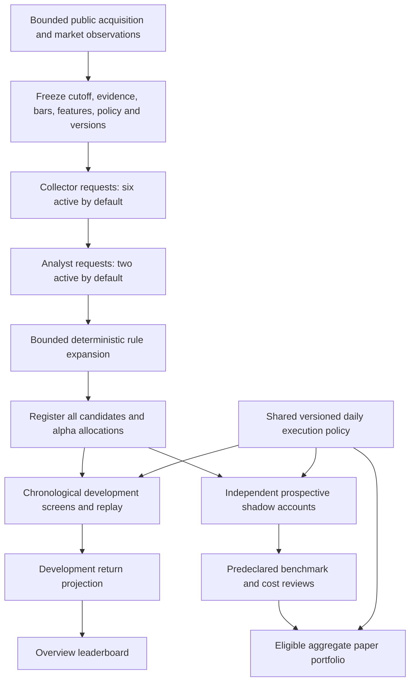
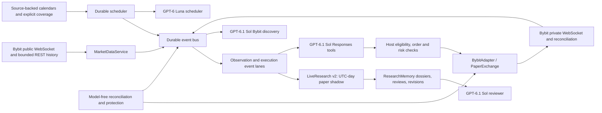

# Architecture

Prism combines a native macOS console with a local Python runtime. The daily-equity v1 research lane remains paper-only; a separate event-driven Bybit v2 lane supports exact-instrument research, durable reviews, paper exchange simulation, and operator-gated GPT-6.1 Sol Responses execution. Host code owns identity, evidence, eligibility, order validation, risk, reconciliation, and accounting. Historical results remain development evidence.

The diagram below describes the daily-equity v1 research flow; the Bybit v2 workers are separate and are shown after it.

## Evidence-to-candidate flow

The available roster is 24 GPT-6 Luna low collectors, six GPT-6.1 Sol medium analysts, two optional GPT-6.1 Sol high strategists, and one GPT-6.1 Sol max executor. Defaults activate six collectors and two analysts; strategist and v1 executor reviews remain optional advisory comparisons. The host assigns source shards, gathers all source content before model fan-out, filters evidence by the cycle cutoff, and caches unchanged research inputs. It remaps parent links so active analysts can receive collected findings. Concurrency defaults to eight and is configurable up to 32.

Each role manual is loaded from `backend/agent_roles/`; its complete text is sliced to 6,000 characters in the provider request. Strict JSON schemas cap array sizes and disallow extra properties. Collectors receive supplied evidence and coverage counts. Analysts and upper layers can receive original source documents and source-coverage metadata instead of relying only on compressed findings. Analysts receive at most the last 100 market bars for supplied symbols; whole records may be dropped when the request byte budget is reached. `information_cutoff_ms` filters future source and market observations. Exact analyst quotes must be substrings of the supplied documents.

The analyst may return up to eight hypotheses per request. Host code expands each distinct valid proposal using a predeclared local lookback/threshold grid; defaults are 16 candidates per proposal and 256 candidates per cycle. The full set is registered before outcomes are evaluated. Duplicate canonical rules retain their first identity, policy, registration time, and context; later attempts remain recorded. All attempted/deferred candidates contribute to trial accounting. The offline `research.py search` command performs a separately bounded Cartesian grid over a frozen dataset, with a default cap of 256 and hard cap of 5,000.

The only executable families are long/flat momentum, mean reversion, breakout, and structured numeric event surprise. Event features need sourced actual/expectation values and dates. Narrative sentiment, arbitrary code, industry totals, or confidence scores cannot become a rule feature. Model-proposed mechanism and market rule must remain distinct: the host tests the frozen signal rule and does not directly estimate a causal revenue or margin effect.

## Development measurement

Historical evaluation is explicitly labeled development. For daily equities the current evaluator uses a chronological train/holdout split and canonical frozen rule and policy. Daily equity replay and prospective paper execution call the shared simulation engine for signals, observed sessions, costs, corporate actions, liquidity, portfolio accounting, and exposure controls. The engine queues a completed-session signal for a future observed open; it does not invent intraday stop ordering from daily data. Missing raw-price basis, session times, corporate-action data, or required benchmarks can make a report inconclusive. The legacy minute-bar fixture path is regression compatibility only.

The current daily equity development screen requires positive net results in train and holdout, at least eight completed trades in each, twelve nonzero holdout blocks, an exposure-matched buy-and-hold comparison, a 20% holdout drawdown ceiling, and trial-adjusted sign-test evidence. Blocks are at least `max(8, lookback)` sessions; absolute lag-one block correlation above 0.5 fails the screen. Additional reports cover increased transaction-cost assumptions, missed opening observations, walk-forward segments, and neighboring lookbacks. These controls depend on approximate block independence and stationarity; a passing screen is not evidence of profitability.

Candidate alpha is allocated across unique experiments and distinct datasets. Prospective review separately requires enough registered future observations, complete valuations, completed round trips, positive returns after allocated operating costs, and excess over stock, market, and sector comparisons. Review checkpoints and alpha shares are predeclared. Review blocks span at least the rule lookback and policy holding horizon. Missing benchmarks prevent promotion; later deterioration can retire a promoted rule. See [Research contract](ResearchContract.md) for details and caveats.

## Daily-equity v1 execution and interface

The shared daily policy handles next-observed-open commitments, fees, spread, slippage, impact, participation, stops, holding-session limits, split/dividend accounting, entry budgets, and drawdown halt. Entry ceilings include 10% per symbol and 30% gross by default; participation and correlation limits also apply. Stale observations, missing session prices, full participation budgets, unsupported policy identity, or incomplete risk state can block fills. A kill switch blocks entries and attempts exits only when fresh prices and participation allow them; it does not guarantee liquidation.

Daily-equity v1 strategist and executor model calls are disabled by default. If enabled, their responses are saved as advisory comparisons; v1 orchestration does not use them to change candidate selection, eligibility, risk, or fills. Deterministic host code advances shadows and paper activity.

`/v1/state` includes a bounded research summary. The Overview's development leaderboard shows at most 100 latest development evaluations, ordered by historical net return, with missing returns last. It includes screen/provenance/qualification context, but rank has no prospective effect and the projection is not a promotion gate. A distinct forward report is based only on observations after registration.

## Event-driven Bybit v2 runtime

Independent worker lanes isolate market reading, event processing, discovery, review, planning, account reconciliation, private exchange events, and model-free protection. WebSocket callbacks only enqueue durable events. A new input, fill, risk state, review trigger, sourced calendar boundary, or data-health change wakes work; there is no fixed hourly model loop. A stalled or budget-exhausted scheduler call does not hold up ingestion, reconciliation, or protection. The source-backed scheduler validates bounded model plans and has deterministic fallbacks for events, missing coverage, stale data, review backlog, positions, and orders. It owns no account or order capability.

Bybit discovery requires an exact operator-selected `{category, symbol}` pair and freezes metadata and closed OHLCV history before the model request. A request may include 500 bars for each supported interval (`1`, `5`, `15`, `60`, `D`) and up to two relevant prior dossiers bounded to 8 KB each. These observations are development evidence. Exchange metadata rejects unsupported TradFi, inverse, and options products; a listed-equity symbol does not alias a Bybit market.

ResearchMemory persists bounded dossiers, review inputs and results, continuation summaries, and parent/child revision links. Runtime review requests receive up to 48 KB of dossier context; reconciliation updates position, order, fill, and risk state without overwriting the last meaningful execution conclusion. Persisted risk halts and rejected orders can queue reviews. Reviewers can recommend observation, more data, a separate rule revision, or retirement. Host code applies the outcome. Revisions receive new identities and cannot inherit prospective evidence or weaken qualification.

When all operator and host checks pass, the event execution lane sends actual GPT-6.1 Sol Responses requests at high reasoning effort. Its initial packet contains a 16 KB-bounded strategy dossier, the exact policy-required OHLCV history and supporting frames, any forming observation, source-backed scheduled-event context, and current host constraints. Its bounded function surface exposes strategy/market/account/order reads and requested order operations. The host rechecks exact version approval, fresh market and account state, instrument allowlists, risk budgets, and runtime permission before an exposure-increasing mutation. GPT-6.1 Sol cannot load credentials or call exchange endpoints directly. The mode-aware Bybit adapter performs exchange reconciliation and journals orders, executions, transactions, positions, and account state. Cash Spot protection uses a verified conditional sell `StopOrder`; because Bybit does not reserve base assets before trigger, Prism locally reserves that quantity and requires cancellation/fill reconciliation before another sell. Linear positions use verified exchange position stops. Paper mode uses a local `PaperExchange` fixture. Mainnet is gated by both config booleans and `PRISM_BYBIT_MAINNET_ENABLED=1`, and remains disabled by default.

Bybit v2 qualification counts at most one verified mark per UTC calendar day and requires at least 60 distinct future UTC days after registration. Multiple one-minute bars do not satisfy the day requirement. Daily-equity v1 qualification remains unchanged. Spot entries require the cash conditional stop verification and local inventory reservation described above; linear entries require a verified exchange-side position stop. See [Continuous runtime](ContinuousRuntime.md) for the complete activation and risk envelope.

## Storage and safety boundary

SQLite retains source evidence, immutable snapshots, model requests/responses, candidate attempts, evaluations, observations, review dossiers, event tasks, Bybit mode-namespaced ledgers, and portfolio accounting. Public fetching applies request, page, byte, crawl-depth, host-pacing, robots, DNS/address-pinning, and redirect checks. The authenticated local control API binds to loopback. No model receives credentials or unrestricted shell/browser/network access. Daily-equity v1 remains paper-only. Bybit v2 GPT-6.1 Sol has only the narrow execution tools; mainnet and live execution are off until separate operator gates are configured and Start is pressed. The service starts paused, while a configured Bybit account is read and reconciled on paused restart. Exposure checks consult the durable order journal as well as the current projection, and configuration changes share the execution-mutation lock. Mode/account identity changes require a paused and flat account, then restart; a different UID needs a separate state directory.

For the full task contracts, see [Agent procedures](Agents.md). For operator controls, data coverage, and the offline dataset format, see [Runtime](Runtime.md). For end-to-end research choices, see [Research workflow](ResearchWorkflow.md).

## Evidence adapters and replay integrity

Public acquisition supports RSS/Atom, news feeds, bounded HTML bodies and publication metadata, and YouTube channel-feed metadata. Full transcripts enter through the normalized import boundary. [Monid integration](Monid.md) documents the optional explicit command, private host credential, receipt provenance, and shared research-pool ingestion. Model calls receive evidence, never connector credentials or arbitrary API execution authority.

Daily-equity validation fingerprints the signal history, raw execution prices, corporate actions, benchmark inputs, and adjustment declarations within the tested window. Missing adjustment declarations and unsupported asset classes fail closed; explicitly labeled synthetic fixtures retain a compatibility path for regression tests. Strategy and benchmark terminal values both use marked open positions under the shared execution policy, without hypothetical exit charges. Reports label that valuation basis.

Ordered replay histories use bounded views and in-place private replay accounting, while public advance calls preserve defensive copies. Frozen runtime histories are decoded once per snapshot. Exact search runs and per-candidate reports are cached with engine and store implementation hashes. Search claims retain process ownership; exceptions release the claim and dead workers can be reclaimed. Upper-layer memory queries use bounded bulk projections rather than a query per candidate.
