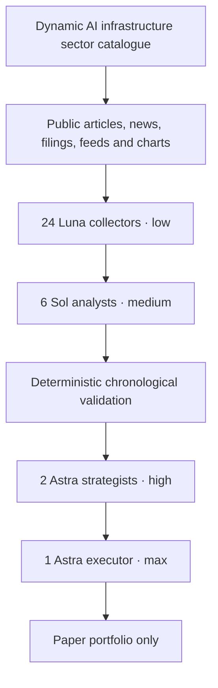

# Architecture

Prism is a research harness for AI infrastructure equities. Broad public-source collection feeds a fixed reverse cascade; measured claims and trading decisions remain under deterministic host control.

## Fixed roster and budgets

The roster remains 24 GPT-6 Luna low, 6 GPT-6.1 Sol medium, 2 GPT-6 Astra high and 1 GPT-6 Astra max: 33 agents total. Default concurrent model work is 8, configurable up to 32. Existing OpenAI credentials are used; there is no Gemini runtime. Each cycle admits up to 4,000 shared evidence items. Collection is designed to accommodate 24 collectors and larger-than-1 MB aggregate evidence packets; request and per-item bounds still apply.

## Catalogue and collection

The `ai_infrastructure` sector entry has `id`, `max_symbols` (80), `discovery_enabled` (true), `seed_symbols`, and `keywords`. MRVL, NBIS, APLD, CRWV, IREN and MU are illustrative seeds, not a whitelist. Discovery and its fallback seed list must be observable, including the reason a fallback was used.

Sources include public articles, news, company material, feeds and chart data. Collector assignments divide sources and symbols across the sector. Extracted article bodies remain in evidence records; model packets include recent chart excerpts and retain source identity. Collection limits are 48 pages, 160 requests, 90 seconds and crawl depth 2; each response is bounded at 1 MB and extracted content at 24,000 characters. Keep 256 shared evidence items and up to 1,260 daily candles per symbol. Public-data fetching uses Python's standard library only. It does not invoke models, a shell, a browser, or credentialed sources.

All collectors share request pacing, robots policy, DNS validation and caches. Public HTTPS destinations are pinned to validated public DNS addresses; redirects are revalidated. Host delays, cache behavior, source errors and catalogue fallback are visible in run records. Coverage is bounded and source failures do not count as successful evidence.

## Evidence and model boundaries

Collectors return facts with source IDs, URLs, timestamps and content identity, labeling interpretation and speculation separately. Analysts challenge duplication and cross-check claims, then state hypotheses without inventing statistics. The host freezes each proposed rule and computes chronological validation statistics. Strategists may select only admitted, frozen rules. The executor can recommend a paper action or abstention, but deterministic execution controls freshness, sizing, costs and accounting.

Documents and market data are untrusted input, not instructions. No role can change routing, permissions, budget ceilings, admission gates, or execute arbitrary code. Model output is validated against known identifiers and provenance before downstream use.

## Persistence and upgrade behavior

SQLite stores catalogue/configuration, source records, handoffs, validation results, events and paper accounting. On upgrade, archive the prior crypto configuration, portfolio, markets and decisions before initializing the equity configuration. Every start begins paused. Historical crypto state is retained for reference and is not treated as equity evidence or portfolio state.

## Research and paper execution

The Yahoo Finance public chart endpoint is unofficial and delayed. The intended equity series is adjusted daily OHLCV, with a maximum request history of 1,260 sessions. Preserve actual quote time and freshness; 120 seconds is the maximum quote age for new paper fills. Never substitute stale after-hours data for a fresh executable quote. New listings with fewer than 300 usable daily observations are insufficient for statistical admission. Session gaps are valid and must not be fabricated into bars.

Validation requires chronological partitions and frozen rules. The model cannot claim a measured return, Sharpe ratio, p-value or drawdown; the host computes and records these. Paper fills remain simulated. Nothing in the architecture submits broker orders or establishes profitability.

## Statistical admission

The supported rule families are long/flat momentum, mean reversion and breakout. Signals use closed bars and execute at the next open, with six basis points of fees and three basis points of slippage on each side. Evaluation requires at least 300 unique, regular, chronological closed bars and splits them into 65% training and 35% holdout without tuning on the holdout.

Admission requires positive net returns and at least eight completed trades in both partitions, drawdown no greater than 20%, and at least 12 nonzero, disjoint holdout blocks. Blocks span at least eight bars or the rule's lookback, whichever is larger. Host code checks absolute lag-one block correlation no greater than 0.5 and uses a one-sided exact binomial sign test with a cumulative Bonferroni trial correction; the adjusted threshold is 0.05. The validated rule is frozen for downstream selection.

These checks depend on approximate block independence and stationarity. They do not turn a p-value into a probability of profit, establish complete independence after repeated research, or guarantee execution outcomes. Insufficient evidence produces a rejected or inconclusive result.

## Paper portfolio constraints

The paper engine supports spot long positions, limits one symbol to 10% of equity and total gross exposure to 30%, and requires quotes no older than 120 seconds. It closes positions at a 5% stop or after 24 hours; a 10% portfolio drawdown halts entries until the paper account is reset. The kill switch liquidates only when a fresh observed quote is available. Stale or unavailable quotes do not become invented fills.

The executor may request activate, hold or close for admitted strategies. It supplies no arbitrary order payload or size: the deterministic engine owns sizing, freshness checks, cost accounting and duplicate protection.
