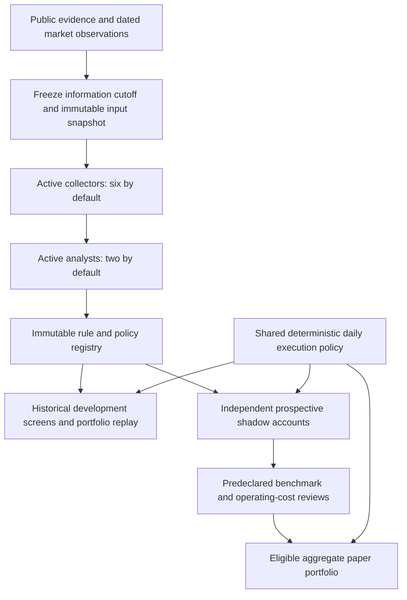

# Architecture

Prism is a paper-only research service with a native macOS console. Historical material is development data. Deterministic code registers frozen hypotheses, evaluates them, and measures new prospective observations.

The available roster remains 24 Luna collectors, six Sol analysts, two Astra strategists and one Astra executor. Defaults use six collectors and two analysts; the host remaps their reporting links so active analysis receives the collected findings. Selection and authorization are deterministic. Optional strategist/executor calls record advisory comparisons and cannot alter rules, admission or fills. Development subagents default to Luna separately from runtime routing.

Acquisition completes before model work. Source content, daily histories, features, configuration and code/prompt versions are frozen for each cycle. Cutoff filters remove future sources, quotes and bars; original documents are supplied to analysts under an explicit packet budget. Exact source excerpts, a mechanism, prediction horizon and invalidation are required. Missing or unsupported claims produce visible rejection records.

All existing history, present-day universe membership, current news and model knowledge remain development inputs. A historical chronological screen is never called an untouched prospective result. Candidates are registered before historical scoring; duplicate economic rules preserve their original policy, context and registration time. Rejections, evaluated variants, responses and snapshots remain in SQLite. Historical screening cannot promote a candidate.

`simulation.py` owns daily opening commitments, costs, liquidity participation, accounting and risk rules. Both historical replay and real-equity paper execution call this engine. Replay requires provider-declared unadjusted execution prices and observed historical session times; missing metadata yields an inconclusive report. The legacy minute-bar fixture path remains available for regression compatibility and is not used for equity execution.

A completed-session signal queues an order for an observed future session open. Registration and commitment must precede that open; an opening observation missed by more than 120 seconds is not backfilled. Fees, spread, slippage and impact assumptions are shared. Stops are evaluated on completed-session closes and executed at a later eligible open; daily data never invents intraday stop ordering. Holding limits count observed sessions. Entry budgets cap symbol, gross and correlated exposure, while price-driven exposure drift remains visible in marked positions. Liquidity limits constrain buys and partial exits. A kill switch blocks entries and attempts fresh-price exits within available participation; it does not guarantee full liquidation.

Splits change quantities and entry prices without changing cost basis. Dividend entitlements accrue separately from cash until an observed payable date exists. Corporate-action IDs, liquidity usage and consumed economic signal IDs survive repeated ticks and strategy display-ID changes. Cash, equity, realized and unrealized P&L reconcile after each execution.

Independent shadow accounts compare each frozen rule with stock, market and sector buy-and-hold accounts using the same accounting and modeled costs. Future reviews require enough observed sessions, completed round trips and disjoint return blocks, positive operating returns, benchmark excess, acceptable drawdown and search-adjusted evidence. Review blocks are at least as long as the rule lookback and policy holding horizon. Review dates and alpha allocations are predeclared. Missing benchmarks or incomplete valuation prevent promotion. Deterioration at a later scheduled review retires a previously promoted candidate.

The registry spends a summable alpha budget across unique experiments and review checkpoints. These inference checks still depend on approximately independent, stationary block signs. No p-value is converted into a probability of profit.

Public fetching retains bounded requests, bytes, crawl depth, host pacing, robots handling, validated public DNS/address pinning and redirect checks. Models receive no credentials, tools, shell or broker access. The local bearer-authenticated control API remains loopback-only. Starts remain paused. The protocol migration archives prior cycles and nonempty simulated accounts; existing source and research history is retained.

See [Research contract](ResearchContract.md), [Runtime](Runtime.md), [Task procedures](Agents.md) and [Validation](Validation.md).
