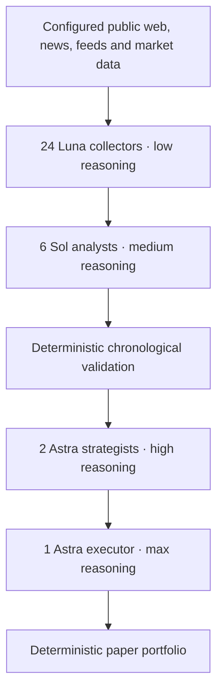

# Architecture

Prism uses a reverse cascade: broad information collection feeds a smaller set of analysts, then fewer strategists, then one execution decision agent. Model capability and reasoning effort increase as the number of agents decreases. The native console keeps its existing UI and receives state from the new backend.

## Information contracts

Collectors receive bounded source batches and return concise findings with provenance. Analysts receive collected findings and training-period market observations, then propose bounded hypotheses and describe uncertainty. Host code scores their frozen rules on chronological partitions and promotes only admitted edges. Strategists select from those validated edges, preserve the rule parameters and turn them into source-linked declarative strategies. Host code checks each strategy against the frozen validated rule before the execution layer considers it. The final paper engine applies deterministic execution and portfolio limits.

Each downstream handoff narrows the information volume. Typed validation, known identifiers and source references keep model output attached to evidence. A source's text is data: it cannot change an agent's instructions or the host's tool permissions. Unsupported references and invalid specifications are rejected instead of being promoted as successful findings.

The model layers organize evidence and choose hypotheses. Deterministic code computes return statistics, validation outcomes, sizing, fills and accounting. An assertion made by a model is never treated as a measured Sharpe ratio, p-value or trading return.

## Runtime boundaries

The Python package separates configuration, typed cascade records, source acquisition, provider calls, statistical evaluation, paper execution, persistence, orchestration and the HTTP interface. A cycle is owned by the runtime; it moves through the four layers with bounded worker concurrency and cancellation checks. A layer cannot introduce arbitrary executable strategy code or bypass admission gates.

SQLite holds the new cascade's configuration, roster, documents, results, events and accounting. A fresh database starts paused. The launcher uses `cascade.sqlite3` and a dedicated process lock. Historical databases remain separate and are not migrated into the cascade.

The HTTP interface retains the native app's existing JSON fields and controls. Additive `cascade` metadata describes layer progress for diagnostics. The SwiftUI source and decoding model stay unchanged. Existing screens show the new agent roster, findings summarized in agent reports, strategy outcomes, paper positions, budget and events.

## Collection and execution scope

Collection starts from configured public sources. The fetcher enforces public HTTPS access, robots policies, pacing and bounded crawl work. Retrieval can fail or return stale material, and those outcomes remain observable. Coverage is determined by source configuration and runtime limits.

Paper execution uses public market observations and simulated fills with host-controlled costs and portfolio constraints. The architecture has no real-money exchange order path. Improving a model or increasing collector counts does not itself establish statistical validity or profitability.

## Statistical admission

The supported rule families are long/flat momentum, mean reversion and breakout. Signals use closed bars and execute at the next open, with six basis points of fees and three basis points of slippage on each side. Evaluation requires at least 300 unique, regular, chronological closed bars and splits them into 65% training and 35% holdout without tuning on the holdout.

Admission requires positive net returns and at least eight completed trades in both partitions, drawdown no greater than 20%, and at least 12 nonzero, disjoint holdout blocks. Blocks span at least eight bars or the rule's lookback, whichever is larger. Host code checks absolute lag-one block correlation no greater than 0.5 and uses a one-sided exact binomial sign test with a cumulative Bonferroni trial correction; the adjusted threshold is 0.05. The validated rule is frozen for downstream selection.

These checks depend on approximate block independence and stationarity. They do not turn a p-value into a probability of profit, establish complete independence after repeated research, or guarantee execution outcomes. Insufficient evidence produces a rejected or inconclusive result.

## Paper portfolio constraints

The paper engine supports spot long positions, limits one symbol to 10% of equity and total gross exposure to 30%, and requires quotes no older than 120 seconds. It closes positions at a 5% stop or after 24 hours; a 10% portfolio drawdown halts entries until the paper account is reset. The kill switch liquidates only when a fresh observed quote is available. Stale or unavailable quotes do not become invented fills.

The executor may request activate, hold or close for admitted strategies. It supplies no arbitrary order payload or size: the deterministic engine owns sizing, freshness checks, cost accounting and duplicate protection.
